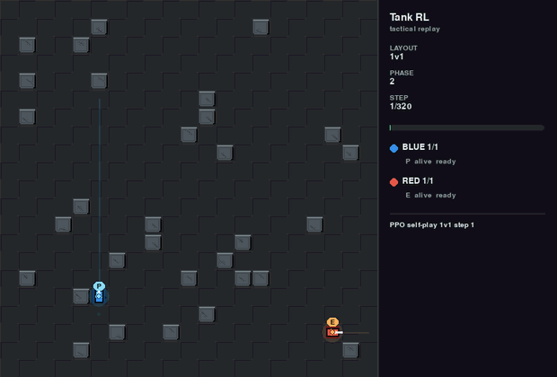

<div align="center">

```
██╗██████╗ ███████╗██╗      ██████╗ 
██║██╔══██╗██╔════╝██║     ██╔═══██╗
██║██████╔╝█████╗  ██║     ██║   ██║
██║██╔═══╝ ██╔══╝  ██║     ██║   ██║
██║██║     ███████╗███████╗╚██████╔╝
╚═╝╚═╝     ╚══════╝╚══════╝ ╚═════╝ 
```

## Hey, I'm **Ilay** 👋

**Applied AI student** · I like knowing how things work under the hood

[**🌐 Portfolio**](https://ipelo.github.io) · [**💼 LinkedIn**](https://www.linkedin.com/in/ilay-rakotondravao-322412161/) · [**📦 Repos**](https://github.com/iPelo?tab=repositories)

<br>



<sub>A real match between two of my <a href="https://github.com/iPelo/Tank-Reinforcement-Learning">Tank RL</a> agents. Blue finds red and wins on step 61.</sub>

</div>

---

## 📜 Quest Log

| | Quest | Where | Result |
|---|---|---|---|
| ✅ | Beat "same as yesterday" | [EnergyPriceMLOps](https://github.com/iPelo/mlops-pipeline) | LightGBM won all 6 months, 17% lower error |
| ✅ | Find out if Deutsche Bahn got worse | [BahnDelayStory](https://github.com/iPelo/domain-data-story) | Yes: 14.4% → 21.9% of trains late |
| ✅ | Search German law in plain German | [GermanLawRAG](https://github.com/iPelo/domain-rag-agent) | Reranker fixed everyday questions |
| ✅ | Survive a crash | [bitcask-rs](https://github.com/iPelo/bitcask-rs) | Recovers from half-written data |
| ✅ | Teach tanks to fight | [Tank RL](https://github.com/iPelo/Tank-Reinforcement-Learning) | They hunt each other now |
| 🔄 | Get tanks to win more than they draw | [Tank RL](https://github.com/iPelo/Tank-Reinforcement-Learning) | In progress |

---

## 🎮 Choose Your Class

<details>
<summary><b>🧠 ML Engineer</b></summary>
<br>

**⚖️ [GermanLawRAG](https://github.com/iPelo/domain-rag-agent)**
Search over German federal law (30 laws, about 15k sections) that answers questions with sources. I wrote 96 test questions to compare keyword search, embeddings and a mix of both. Surprise: plain embeddings did better than the mix on everyday questions, and a reranker was needed to fix that.
`Python` · `FastAPI` · `Qdrant` · `BM25` · `React`

**⚡ [EnergyPriceMLOps](https://github.com/iPelo/mlops-pipeline)**
Predicts German electricity prices for the next 24 hours. I tested a neural net against LightGBM and simple baselines over six months of 2024. LightGBM won every month (average error 27.2 €/MWh vs 32.9 for "same as yesterday"), so that's the model the API serves.
`Python` · `LightGBM` · `PyTorch` · `DVC` · `FastAPI` · `Docker`

**🛡️ [Tank Reinforcement Learning](https://github.com/iPelo/Tank-Reinforcement-Learning)**
Tanks that only see part of the game learn to fight each other through self-play with PPO. That's them in the GIF above.
`Python` · `PyTorch` · `PPO`

</details>

<details>
<summary><b>📊 Data Scientist</b></summary>
<br>

**🚆 [BahnDelayStory](https://github.com/iPelo/domain-data-story)**
Are Deutsche Bahn trains getting later? Looking at 49.7M stops in 2025: yes. At the same 107 stations, trains 6+ minutes late went from 14.4% in January to 21.9% in October. ICEs are the worst, but regional trains added most of the extra delays because there are so many of them.
`Python` · `DuckDB` · `pandas` · `Streamlit`

**⚡ [EnergyPriceMLOps](https://github.com/iPelo/mlops-pipeline)**
Same project as above, from the data side: a rolling backtest over six months, so one lucky month can't decide which model wins.

</details>

<details>
<summary><b>🗄️ Systems Engineer</b></summary>
<br>

**🗄️ [bitcask-rs](https://github.com/iPelo/bitcask-rs)**
A small key-value database in Rust, based on the Bitcask paper. It writes everything to an append-only log, recovers after crashes and cleans up old data in the background. There's also a TCP server and a client. No dependencies besides the standard library.
`Rust`

</details>

---

## 🏆 Achievements

[](https://github.com/iPelo/bitcask-rs/actions)
[](https://github.com/iPelo/domain-rag-agent/actions)
[](https://github.com/iPelo/mlops-pipeline/actions)
[](https://github.com/iPelo/domain-data-story/actions)

<sub>Live test status for each project.</sub>

---

## 🗺️ Side Quests

Older projects where I wrote the models myself with NumPy:

- 📈 [Linear Regression](https://github.com/iPelo/Linear-Regression-from-Scratch)
- 🎯 [Logistic Regression](https://github.com/iPelo/Logistic_Regression)
- 🌳 [Decision Tree Classifier](https://github.com/iPelo/Decision-tree-Classifier)

---

## 🎒 Inventory

**Languages:** Python, Rust, SQL, Java, TypeScript  
**ML:** PyTorch, LightGBM, scikit-learn, NumPy, pandas  
**Data & tools:** DuckDB, Qdrant, FastAPI, Docker, DVC, Jupyter

---

<div align="center">

### _"Yep, I'm stupid. But I still do my best."_ 🦫
<sub>— Bidoof, Pokémon Mystery Dungeon</sub>

[](https://github.com/iPelo)

</div>
